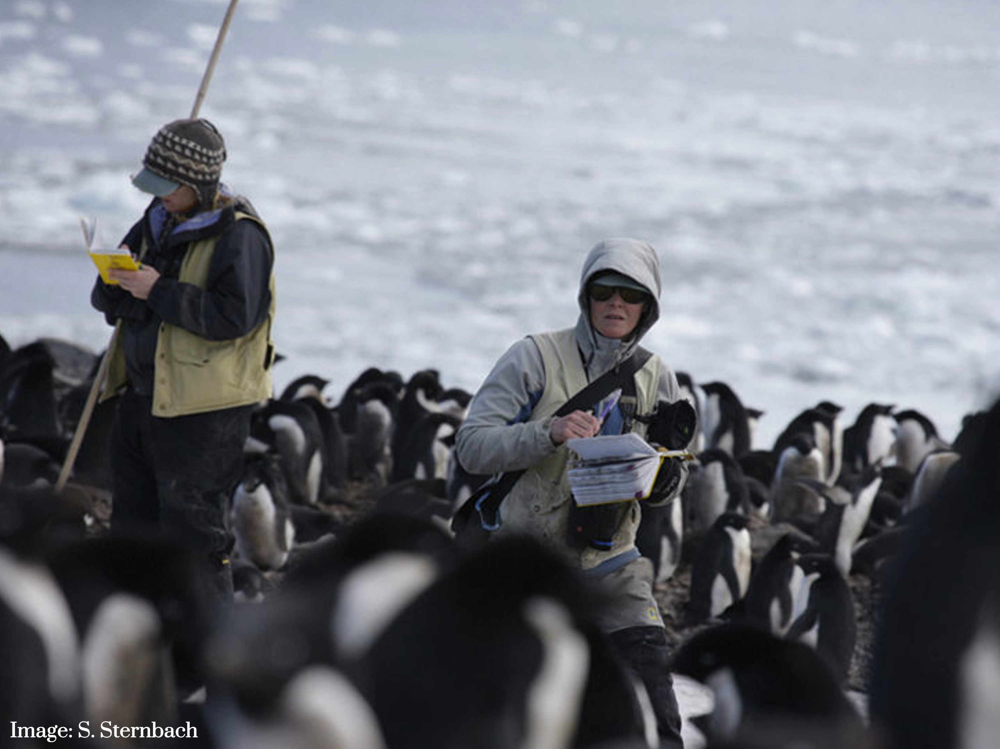
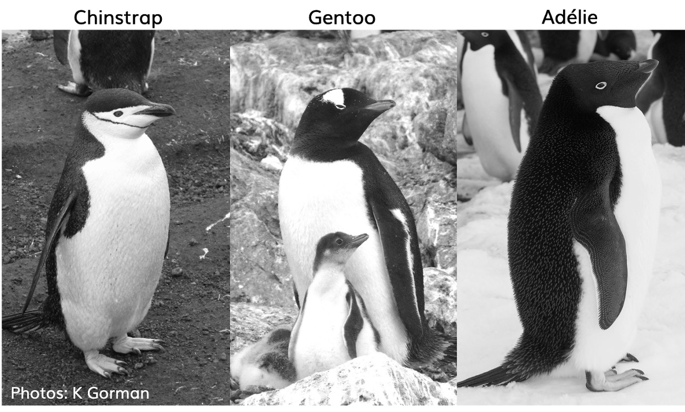

```{r}
#| echo: false
#| output: false
library(tidyverse)
library(magrittr)
library(palmerpenguins)
library(gt)
library(car)
library(broom)
library(scales)

```

## Palmer Penguins Dataset
::: {.columns}

::: {.column width="50%"}

<small>[Source Link](https://education.rstudio.com/blog/2020/07/palmerpenguins-cran/)</small>
:::
::: {.column width="50%"}
- Dr.Kristen Gorman
- สถานี Palmer Station Antarctica
:::


:::
---


<small>[Source Link](https://education.rstudio.com/blog/2020/07/palmerpenguins-cran/)</small>

---

## ข้อมูลพื้นฐานของ dataset

<br>

```{r}
#| echo: false
adelie.org <- penguins %>% 
  select(species, island, body_mass_g, sex) %>% 
  filter(species == "Adelie")

adelie.org %>% 
 glimpse()
```

---

## ข้อมูลพื้นฐานของ dataset

<br>

- Species (`r  unique(adelie.org$species)`)
- Island (`r unique(adelie.org$island)`)
- Body_mass_g
- Sex (`r unique(na.omit(adelie.org)$sex)`)

---

## Missing Values

<br>

```{r}
#| echo: true
colSums(is.na(adelie.org))
```

---